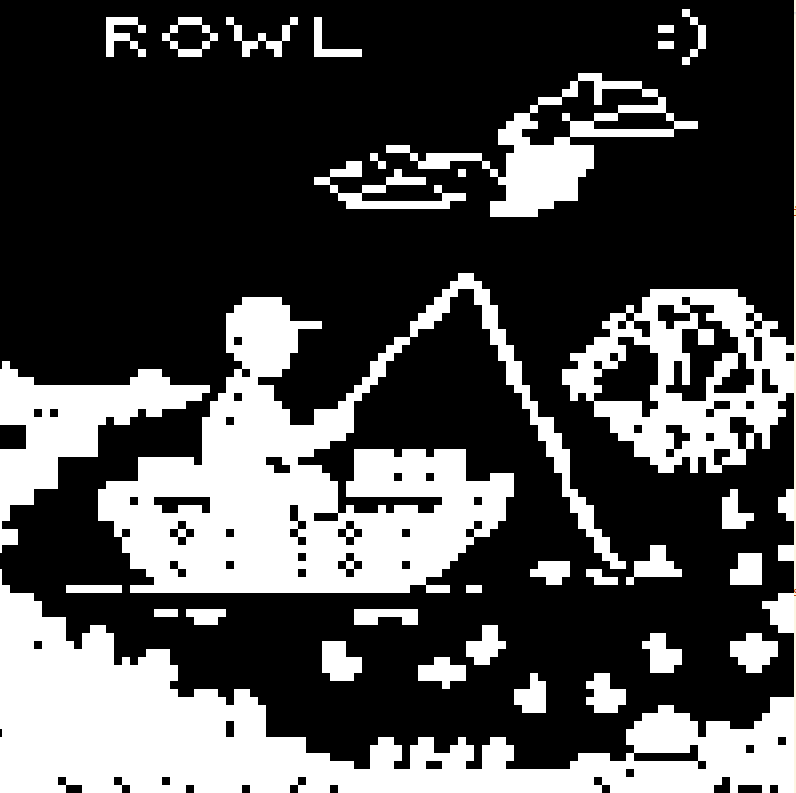

# GRF -> LAB2 - Conway's Game of Life
*edit no hay canal en el discord para publicar el gif aún


## Demostración de Ejecución


## Diseño de la pantalla inicial - Un pescador en la noche feliz :P


---

## Características Principales

**Controles de Teclado**:
   - `Espacio`: Pausar / Reanudar la animación.
   - `R`: Reiniciar el tablero al estado inicial.
   - `ESC`: Salir del programa.

## Requisitos y Ejecución

### Pre-requisitos
- Tener instalado [Rust y Cargo](https://www.rust-lang.org/).

### Ejecutar el Proyecto
```bash
git clone https://github.com/R-0WL/GRF-LAB-2--Conways-Game-Of-Life
cd GRF-LAB-2--Conways-Game-Of-Life/
cargo run
```


